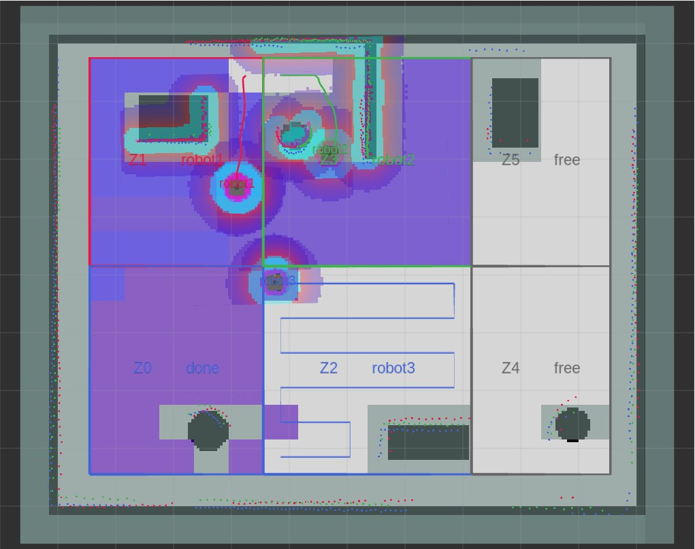
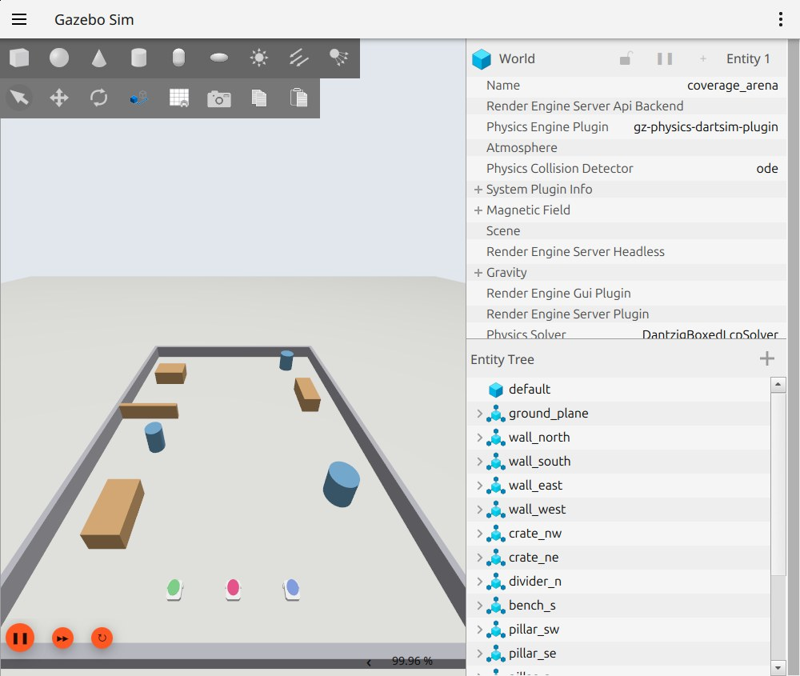
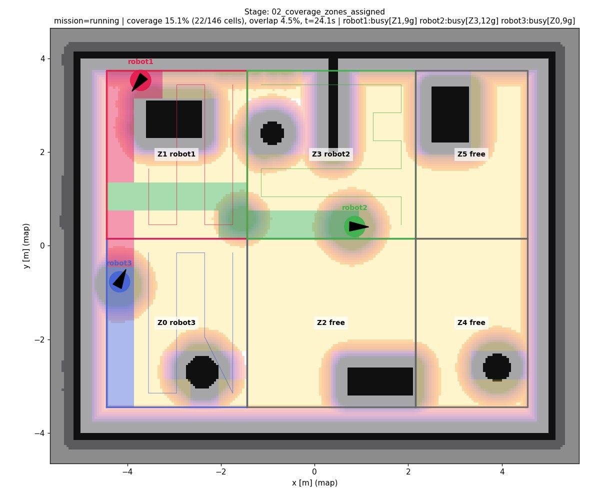
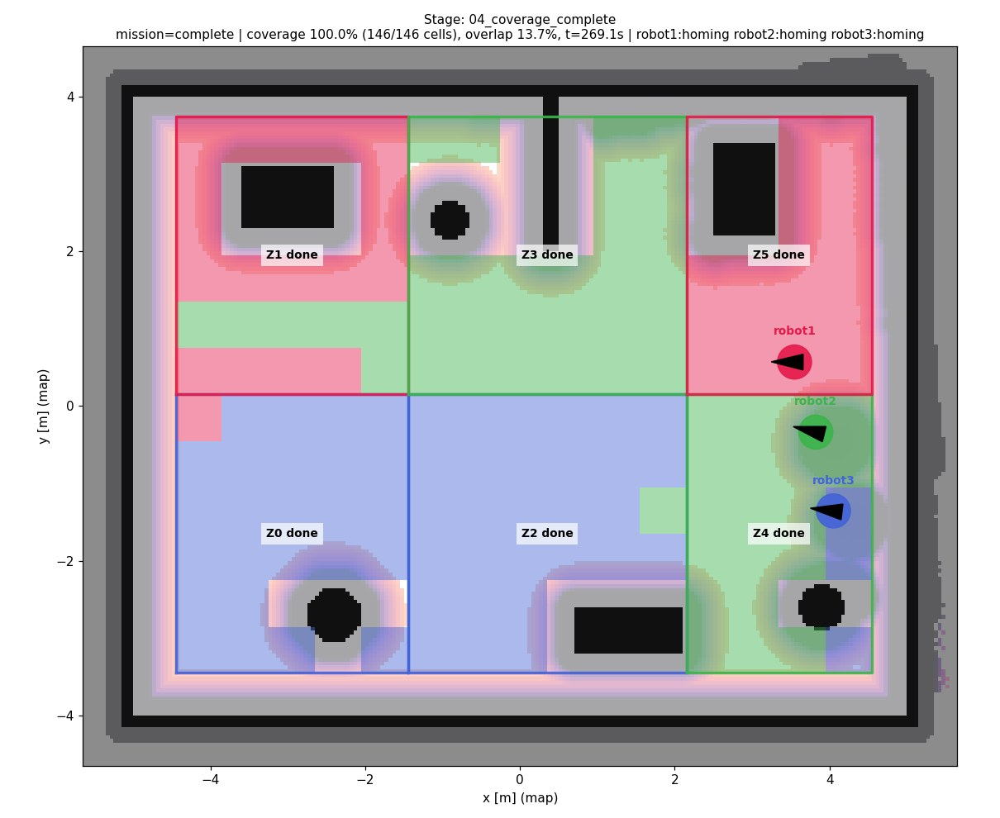
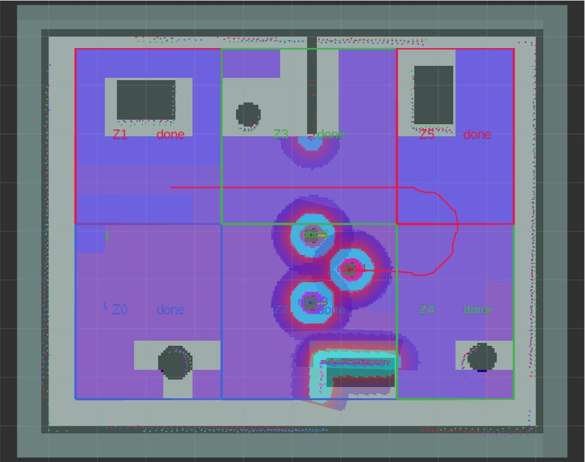
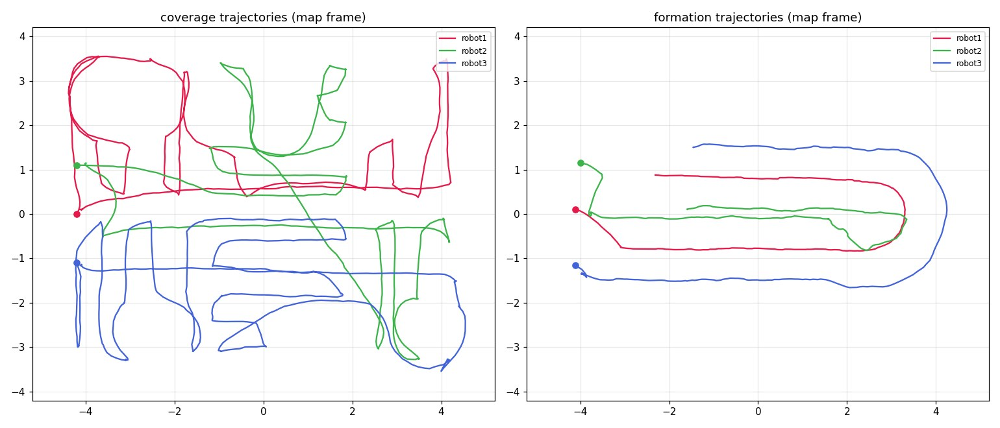
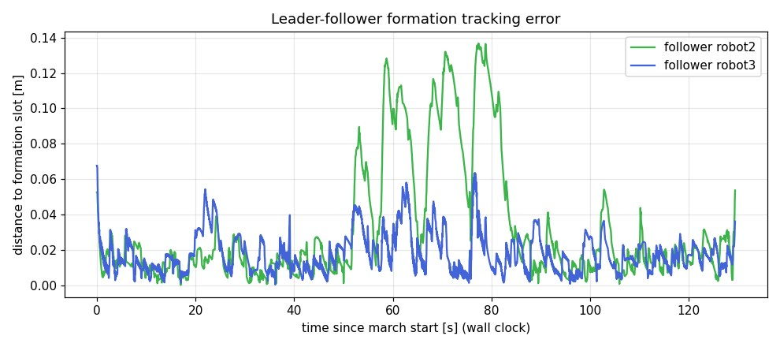

# Multi-Robot Collaborative Coverage & Formation Control

**ROS 2 Jazzy · Nav2 · Gazebo Harmonic · Python · C++**

Three TurtleBot3 Waffle robots in Gazebo, each running its own namespaced Nav2 stack. They do two missions:

1. **Collaborative coverage.** A central coordinator splits the map into zones and assigns them to robots as the mission runs, so the fleet covers the whole area without two robots sweeping the same zone.
2. **Leader-follower formation.** Two followers hold a V formation behind a leader. They track it through TF2 poses and send namespaced velocity commands. A custom costmap layer, combined with Nav2's inflation layer, keeps the robots apart.



## Results (simulation)

| Metric | Result |
|---|---|
| Area covered | **100%** (146/146 cells, 52.6 m²) in 269 s |
| Formation slot error | **2.5 cm** mean, 13.7 cm max (14 m route with a U-turn) |
| Failed Nav2 goals | 0 |

## How it works

**One Nav2 stack per robot.** Each robot's topics, actions and lifecycle nodes live under its own namespace (`/robot1`, `/robot2`, `/robot3`). All three share a single TF tree, with frames prefixed per robot (`robot1/odom`, `robot1/base_footprint`, ...). One map server serves all three AMCL instances.



**Coverage coordinator** (`mrc_fleet/coverage_coordinator.py`):
- Splits the free space into equal-area zones. There are more zones than robots, so assignment stays dynamic.
- Plans boustrophedon (back-and-forth) sweep lanes inside each zone.
- Makes the first assignment with Hungarian matching (minimum total travel).
- When a robot finishes, it takes the nearest free zone. If none are left, it takes half of the busiest robot's remaining lanes.
- Each zone has exactly one owner, and cells another robot has already covered are skipped.
- If a robot goes offline, its unfinished work goes back to the pool for the others.

| Zones assigned | Coverage complete |
|---|---|
|  |  |

**Formation controller** (`mrc_fleet/formation_controller.py`):
- Each follower steers a look-ahead point onto its slot behind the leader (feedback linearisation), with the leader's motion as feed-forward.
- Commands go to `/robotN/cmd_vel_nav`, so they still pass through each robot's velocity smoother and collision monitor.
- The leader drives with Nav2 and slows down when a follower falls behind.



**Inter-robot collision avoidance** (`mrc_costmap_plugins`): a C++ Nav2 costmap layer (`PeerLayer`) marks the other robots as obstacles in each robot's costmap, and the standard inflation layer then keeps a safe distance around them. This is needed because each lidar scans at a height where it can't see the other robots.




## Packages

| Package | Contents |
|---|---|
| `mrc_description` | TurtleBot3 Waffle model with a per-robot namespace, frame prefix and colour |
| `mrc_gazebo` | Arena generator (world + matching map), simulation launch, ROS–Gazebo bridges |
| `mrc_navigation` | Templated Nav2 parameters, per-robot Nav2 launch, shared map server |
| `mrc_costmap_plugins` | `PeerLayer` costmap plugin (C++) |
| `mrc_fleet` | Coordinator, coverage planner, formation controller, fleet monitor, demo runner, unit tests |
| `mrc_bringup` | Simulation, base-station and real-robot launch files, fleet parameters, RViz config |

## Run it

Requires Ubuntu 24.04, ROS 2 Jazzy, Gazebo Harmonic, Nav2 and `nav2_minimal_tb3_sim`.

```bash
mkdir -p ~/multi_robot_ws && cd ~/multi_robot_ws
git clone https://github.com/Nikhilesh-003/multi-robot-coverage-formation.git tmp && mv tmp/src . && rm -rf tmp
source /opt/ros/jazzy/setup.bash
rosdep install --from-paths src --ignore-src -y
colcon build --symlink-install
source install/setup.bash

ros2 launch mrc_bringup sim_bringup.launch.py   # terminal 1: Gazebo, 3x Nav2, coordinator, RViz
ros2 run mrc_fleet demo                         # terminal 2: coverage, then formation; exit code = pass/fail
```

Unit tests: `colcon test --packages-select mrc_fleet`.

## Hardware

The same Nav2 and fleet launch files run on real TurtleBot3s with simulation time turned off. `robot_hw.launch.py` runs on each robot, and `base_station.launch.py` runs the map server, coordinator and formation controller. These launch files haven't been tested on physical robots yet.

---

By [Nikhilesh Kumar](https://nikhilesh-kumar.vercel.app/) · [LinkedIn](https://www.linkedin.com/in/nikhilesh-kumar-bharathi/)
